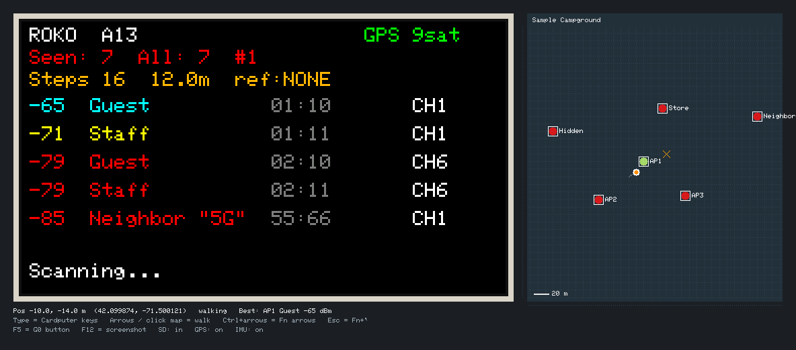

# CardSim: a Cardputer ADV simulator

Run Cardputer sketches on your computer or in a browser, unmodified. You
type on your real keyboard, walk around a simulated property, and the sketch
sees the Cardputer ADV's screen, keyboard, Wi-Fi scanner, microSD card, IMU
(step counting) and the GPS on the Cap LoRa-1262.

**[▶ Try it in your browser](https://memphis-tau.github.io/cardsim/)** with no install needed. Works on phones and tablets too.

It was built around the [Roko Wi-Fi Survey](https://github.com/memphis-tau/cardputer-wifi-survey)
firmware, which runs in it without changes.



## What's simulated

| Hardware | In CardSim |
|---|---|
| 240 × 135 screen | M5GFX drawing calls: text, shapes, sprites (`M5Canvas`), rotation |
| Keyboard | `M5Cardputer.Keyboard` with `isChange()`, `isPressed()`, `keysState()` |
| Wi-Fi scan | `WiFi.scanNetworks()` (sync or async) against access points in a world file. Signal follows a log-distance path-loss model plus noise |
| microSD | `SD` / `File`: a folder on your computer (`sdcard/`) |
| GPS (Cap LoRa-1262) | Real NMEA sentences on a serial port at 115200 baud, from your position. Takes 8 s to get a fix |
| IMU (BMI270) | `M5.Imu`: gravity plus a bounce for each step while you walk |
| NVS | `Preferences`, saved to `nvs.txt` |
| G0 button | `M5.BtnA` / `M5Cardputer.BtnA` |

Not simulated: joining Wi-Fi networks, Bluetooth, the LoRa radio, sound, the
microphone, IR, and 5 GHz (the ESP32-S3 can't hear it either). All fonts draw
with the 6 × 8 classic font, scaled to roughly the size you asked for.

## Try it in a browser

**[Open the live demo](https://memphis-tau.github.io/cardsim/)**

The browser build is one HTML file with the sketch compiled in. It works on
an iPad or iPhone too: tap the screen to bring up the keyboard, and tap the
map to walk.

## Build it on your computer

You need CMake, a C++17 compiler and SDL2. Then point CardSim at a sketch:

```bash
cmake -S . -B build -DSKETCH=/path/to/roko_wifi_survey/roko_wifi_survey.ino
cmake --build build
./build/cardsim_roko_wifi_survey
```

The first build downloads TinyGPSPlus. Your sketch's other `.ino` tabs and
`.cpp` files come along automatically. For other libraries, pass their
folders: `-DSKETCH_LIBS="/path/to/LibA;/path/to/LibB"`.

**Windows:** install [MSYS2](https://www.msys2.org), open the "UCRT64" shell, and run
`pacman -S mingw-w64-ucrt-x86_64-gcc mingw-w64-ucrt-x86_64-cmake mingw-w64-ucrt-x86_64-SDL2 git`.
Then use the commands above, adding `-G "MinGW Makefiles"` to the first one.
(The Windows build hasn't been tested yet. Please open an issue if it breaks.)

**macOS:** `brew install cmake sdl2`. **Linux:** `sudo apt install cmake g++ libsdl2-dev`.

**Browser build:** install [Emscripten](https://emscripten.org), then:

```bash
emcmake cmake -S . -B build-web -DSKETCH=/path/to/sketch.ino
cmake --build build-web        # -> build-web/<sketch>.html
```

Add `-DCARDSIM_WEB_JS_ONLY=ON` for sites whose security policy blocks
WebAssembly. That build is bigger and slower, but it runs anywhere.

### Desktop controls

| Key | Does |
|---|---|
| Typing | Cardputer keys. Enter, Backspace (= Del) and Tab work too |
| Esc | Fn + `` ` `` (Cardputer Esc) |
| Ctrl + arrows | Fn + `;` `.` `,` `/` (Cardputer arrows) |
| Arrow keys | Walk |
| Click the map | Walk to that spot |
| F5 (hold) | G0 button |
| F12 | Screenshot (BMP) |

Options: `--world FILE`, `--data DIR` (where `sdcard/` and `nvs.txt` go,
default the current folder) and `--scale N` (screen zoom, default 3).

## World files

A world is a text file of access points and settings. Positions are metres
east (x) and north (y) of the origin. See `worlds/campground.world` (the
default) and `worlds/open-field.world`.

```
name, Sample Campground
origin, 39.5000000, -98.3500000     # lat, lon of x = 0, y = 0
start, -20, -20                     # where you start

# ap, label, ssid, bssid, x, y, channel [, rssi_at_1m_dbm, path_loss_n, auth]
ap, AP1, Guest, A4:2B:B0:00:01:10, 0, 0, 1
ap, AP3, Guest, A4:2B:B0:00:03:10, 55, -45.3, 11, -34, 3.0
ap, Hidden, "", 02:00:00:00:0A:01, -120, 40, 6

noise_db, 3            # random variation per reading
floor_dbm, -92         # weaker networks aren't seen
gps, on                # Cap LoRa-1262 attached
gps_fix_after_s, 8
imu, on                # off = original Cardputer (no IMU)
sd, on                 # off = no card inserted
```

The path-loss exponent `n` is about 2 in open air and 3 to 4 through
trees, RVs and buildings. The default is 2.7.

## Scripted runs (tests and demos)

`--headless` runs in fast virtual time with no window, following a script:

```bash
./build/cardsim_roko_wifi_survey --headless --data /tmp/run \
  --script "wait 4000; type A13\n; wait 16000; goto 40 -40; waitarrive; \
            key enter; type B17\n; wait 16000; shot end.bmp; quit"
```

Commands, separated by `;`: `wait MS`, `type TEXT` (`\n` = Enter, `\b` = Del,
`\;` = a semicolon), `key enter|del|tab`, `goto X Y`, `waitarrive`,
`teleport X Y`, `shot FILE.bmp`, `quit`. A 7-minute survey takes well under
a second. That makes it easy to check a firmware change against a known walk
and compare the logs.

## Known differences from the real device

* The Arduino IDE writes function prototypes for you, but CardSim doesn't. A
  sketch that calls a function defined further down the file won't compile
  until you add a declaration near the top. (It still compiles on the device
  with the declaration added.)
* Timing is approximate. `millis()` is real time on the desktop and in the
  browser, and virtual time in headless mode.
* A scan reports the signal where you are when it finishes, not an average
  over the ~2.3 s it takes.
* Colours are RGB565, as on the panel, but the screen's gamma and viewing
  angle aren't modelled.

## License

MIT (see LICENSE). The classic font is from Adafruit GFX (BSD). TinyGPSPlus
(LGPL 2.1) is downloaded at build time, not included. See
LICENSE-THIRD-PARTY.md.
